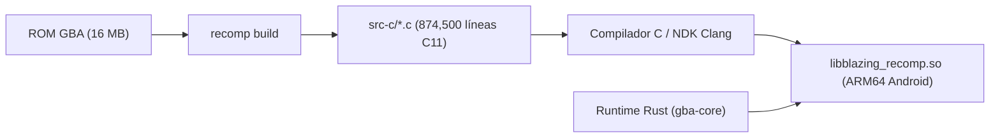

# Arquitectura y Guía de Lectura del Código C Recompilado

Esta guía documenta la estructura, convenciones y funcionamiento interno del código C11 generado por el recompilador estático (`recomp`) para **Fire Emblem: The Blazing Blade** en el repositorio [`blazing-recomp`](file:///c:/Users/felipe-pc/Desktop/PROYECTOS/blazing-recomp).

---

## 1. Visión General del Pipeline

En la recompilación estática binaria, el código máquina original del procesador **ARM7TDMI** de la Game Boy Advance se traduce por adelantado (AOT - *Ahead of Time*) a código fuente en **C11 estándar**:



### Separación de Responsabilidades
* **Código C (`src-c/`)**: Modela **únicamente** la lógica aritmética y de control de la CPU (las 17,207 funciones de bloques del juego).
* **Runtime en Rust (`gba-core`)**: Modela el **hardware físico de la consola** (sincronización de ciclos, dibujo de líneas de pantalla del PPU, mezcla de audio APU/M4A, transferencias DMA y bus de memoria).

---

## 2. Organización de los Archivos en `src-c/`

Debido al volumen de instrucciones (más de 115,000 instrucciones descubiertas), el recompilador divide la salida en unidades de traducción de hasta **16 MB** (`MAX_UNIT`) para permitir compilación paralela y evitar agotar la RAM del compilador:

| Archivo | Tamaño | Líneas | Función en el sistema |
| :--- | :--- | :--- | :--- |
| [`1575 - Fire Emblem (E)(Independent)-bios.0.c`](file:///c:/Users/felipe-pc/Desktop/PROYECTOS/blazing-recomp/src-c/1575%20-%20Fire%20Emblem%20%28E%29%28Independent%29-bios.0.c) | 17.7 MB | ~640,000 | Definición de `RtApi`, macros de banderas (`f_nz`, `op_adds`) y primeros ~13,000 bloques de código del juego. |
| [`1575 - Fire Emblem (E)(Independent)-bios.1.c`](file:///c:/Users/felipe-pc/Desktop/PROYECTOS/blazing-recomp/src-c/1575%20-%20Fire%20Emblem%20%28E%29%28Independent%29-bios.1.c) | 6.4 MB | ~160,000 | Bloques restantes y **tabla maestra de despacho**: el arreglo `rcg_blocks[]` con las 17,207 entradas y `rcg_block_count`. |
| [`1575 - Fire Emblem (E)(Independent)-bios.def`](file:///c:/Users/felipe-pc/Desktop/PROYECTOS/blazing-recomp/src-c/1575%20-%20Fire%20Emblem%20%28E%29%28Independent%29-bios.def) | 89 B | 6 | Archivo de exportaciones para el linker (`rcg_block_count` y `rcg_blocks`). |

---

## 3. Anatomía de una Función de Bloque

Cada bloque de código compilado representa una secuencia ininterrumpida de instrucciones que culmina en un salto o llamada:

```c
uint32_t b_08000a3e_t(const RtApi* a, void* m) {
    uint32_t* c = (uint32_t*)m;
    uint32_t pc; (void)pc;
    
    // 1. Ejecución de instrucciones
    c[13] = c[13] + 4u;
    a->tick(m, 2u);
    
    // 2. Retorno con la dirección del siguiente bloque
    return 0x08000a42u;
}
```

### Nomenclatura:
* `b_`: Prefijo de bloque (*block*).
* `08000a3e`: Dirección hexadecimal de memoria en la GBA donde reside este bloque.
  - Direcciones `08xxxxxx` pertenecen a la **ROM**.
  - Direcciones `03xxxxxx` pertenecen a la **IWRAM** rápida.
* Sufijo de modo:
  - `_a`: Instrucciones en modo **ARM** (32 bits / 4 bytes por instrucción).
  - `_t`: Instrucciones en modo **Thumb** (16 bits / 2 bytes por instrucción). *El 98% de Fire Emblem corre en Thumb*.

---

## 4. El Estado de la CPU: El Arreglo `c[...]`

El parámetro `void* m` recibido por cada función apunta a la estructura de la CPU y memoria en el runtime. Al castearse a `uint32_t* c`, da acceso directo a los registros del procesador ARM7TDMI:

| Índice | Registro ARM | Función en el convenio ABI de C (Intelligent Systems) |
| :--- | :--- | :--- |
| `c[0]` | **r0** | Argumento 1 de función / Valor de retorno principal. |
| `c[1]` | **r1** | Argumento 2 de función / Registro scratch temporal. |
| `c[2]` | **r2** | Argumento 3 de función / Registro scratch temporal. |
| `c[3]` | **r3** | Argumento 4 de función / Registro scratch temporal. |
| `c[4]..c[10]` | **r4 – r10** | Variables locales preservadas por la función (*callee-saved*). |
| `c[11]` | **r11 (fp)** | Puntero de marco (*Frame Pointer*). |
| `c[12]` | **r12 (ip)** | Puntero interno de llamadas intra-procedimiento. |
| `c[13]` | **r13 (sp)** | **Stack Pointer** (Puntero a la pila en IWRAM). |
| `c[14]` | **r14 (lr)** | **Link Register** (Dirección de retorno de la función actual). |
| `c[15]` | **r15 (pc)** | **Program Counter** (Contador de programa). |
| `c[16]` | **CPSR** | Registro de estado: banderas **N** (Negative), **Z** (Zero), **C** (Carry), **V** (Overflow) y bits de modo. |

---

## 5. La Interfaz con el Hardware: `RtApi`

El código C recompilado **no accede a la memoria de la máquina de forma directa con punteros de C**, sino que se comunica con el bus emulado mediante `const RtApi* a`:

```c
typedef struct {
    uint32_t (*interp_one)(void*);                     // Ejecuta 1 paso en intérprete si falta un bloque
    uint32_t (*read8)(void*, uint32_t);                 // Lectura de 8 bits con espejo de memoria GBA
    uint32_t (*read16)(void*, uint32_t);                // Lectura de 16 bits (alineada)
    uint32_t (*read32)(void*, uint32_t);                // Lectura de 32 bits (alineada con rotación)
    void (*write8)(void*, uint32_t, uint32_t);          // Escritura de 8 bits
    void (*write16)(void*, uint32_t, uint32_t);         // Escritura de 16 bits
    void (*write32)(void*, uint32_t, uint32_t);         // Escritura de 32 bits
    void (*tick)(void*, uint32_t);                      // Avanza ciclos de reloj de la CPU
    uint32_t (*guard)(void*, uint32_t, uint32_t, uint64_t); // Valida invariantes en IWRAM
    uint32_t (*chain_gate)(void*);                      // Verificación de interrupciones pendientes
} RtApi;
```

### Regiones de memoria comunes en las llamadas `read` y `write`:
* `0x02000000 – 0x0203FFFF`: **EWRAM** (256 KB) — Datos de guardado temporal, búfers de decompresión.
* `0x03000000 – 0x03007FFF`: **IWRAM** (32 KB) — La pila (`sp`), tablas de interrupción y rutinas de alta velocidad.
* `0x04000000 – 0x040003FE`: **Registros I/O** — `DISPCNT`, temporizadores, DMA y audio.
* `0x05000000 – 0x050003FF`: **Paletas** (1 KB).
* `0x06000000 – 0x06017FFF`: **VRAM** (96 KB) — Tiles y mapas de fondo.
* `0x07000000 – 0x070003FF`: **OAM** (1 KB) — Atributos de sprites (unidades en pantalla).
* `0x08000000 – 0x08FFFFFF`: **ROM del Juego** (16 MB en Fire Emblem).

---

## 6. Funciones de Banderas y Aritmética

En el ARM7TDMI, muchas instrucciones actualizan banderas condicionales según el resultado. En C se emulan con funciones *inline* ultra-rápidas:

* **`f_nz(c, r)`**: Actualiza las banderas **Negative** (bit 31) y **Zero** (resultado igual a 0) en `c[16]` basándose en el resultado `r`.
* **`f_c(c, v)`**: Actualiza la bandera **Carry** (acarreo/préstamo).
* **`op_adds(c, a, b, cin)`**: Suma de 32 bits con acarreo completo. Calcula y almacena simultáneamente las 4 banderas (N, Z, C, V) en una sola operación de 64 bits sin ramas condicionales.
* **`ror32(v, n)`**: Rotación circular a la derecha de 32 bits (utilizada intensivamente por el barrel shifter de ARM).

---

## 7. Desglose de un Caso Práctico (Patrón Real de Fire Emblem)

Observa este bloque extraído de [`src-c/...0.c`](file:///c:/Users/felipe-pc/Desktop/PROYECTOS/blazing-recomp/src-c/1575%20-%20Fire%20Emblem%20%28E%29%28Independent%29-bios.0.c#L137986):

```c
uint32_t b_08000a3e_t(const RtApi* a, void* m) {
    uint32_t* c = (uint32_t*)m;
    uint32_t pc; (void)pc;
    
    // add sp, #4
    c[13] = c[13] + 4u;
    a->tick(m, 2u);

    // pop {r4, r5}
    {
        uint32_t base = c[13];
        c[13] = base + 8u;
        c[4] = a->read32(m, base & ~3u);
        c[5] = a->read32(m, (base + 4u) & ~3u);
    }
    a->tick(m, 5u);

    // pop {r0, r1, r2}
    {
        uint32_t base = c[13];
        c[13] = base + 12u;
        c[0] = a->read32(m, base & ~3u);
        c[1] = a->read32(m, (base + 4u) & ~3u);
        c[2] = a->read32(m, (base + 8u) & ~3u);
    }
    
    c[11] = c[1];  // mov r11, r1 (restaura Frame Pointer)
    c[13] = c[2];  // mov sp, r2  (restaura Stack Pointer)
    a->tick(m, 14u);

    // bx r0 (Salto indirecto con cambio de modo ARM/Thumb)
    { 
        uint32_t t = c[0];
        if (t & 1u) { 
            c[16] |= 0x20u;   // Activa bit Thumb en CPSR
            c[15] = t & ~1u; 
            return (t & ~1u) | 1u; 
        }
        c[16] &= ~0x20u;      // Cambia a modo ARM
        c[15] = t & ~3u; 
        return t & ~3u; 
    }
}
```

### ¿Qué hace este bloque en el juego?
Es el **epílogo de una función** del motor de eventos o renderizado de Fire Emblem:
1. Restaura los registros preservados de la pila (`r4`, `r5`).
2. Recupera los punteros de marco y de pila originales.
3. Lee de `r0` la dirección de retorno y salta a ella alternando el modo del procesador de forma segura.

---

## 8. Guía para Desarrolladores y Modders

1. **No edites a mano los bloques aritméticos:** Modificar operaciones individuales en `src-c/*.c` puede desalinear los ciclos de reloj (`tick`) o el estado de banderas esperado por los siguientes bloques.
2. **Inspección de datos del juego:** Si buscas tablas de personajes, animaciones o textos, consulta las direcciones `0x08xxxxxx` directamente en la ROM utilizando herramientas de la comunidad como `FEBuilderGBA` o el desensamblado `fireemblem7u`.
3. **Persistencia:** Si ejecutas de nuevo `recomp build`, los archivos en `src-c/` serán regenerados. Guarda tus notas de análisis en este directorio `docs/`.
