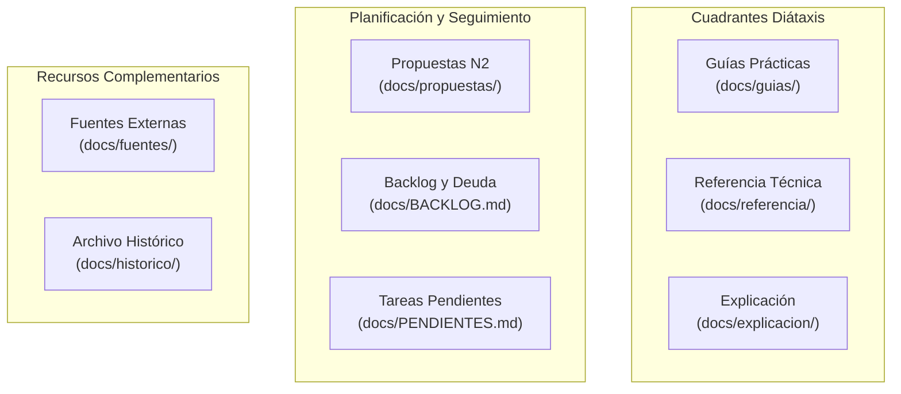

# Portal de Documentación Técnica — Blazing Recomp

Bienvenido a la documentación técnica de **Blazing Recomp**, el port nativo de *Fire Emblem: The Blazing Blade* para Android basado en recompilación estática Ahead-Of-Time (AOT) a C11 y renderizado nativo acelerado por GPU.

El repositorio organiza su documentación bajo el estándar [Diátaxis](https://diataxis.fr/), separando estrictamente las necesidades de aprendizaje, resolución de problemas prácticos, especificaciones de consulta y explicaciones arquitectónicas profundas.

---

## Rutas de Lectura Recomendadas

Para navegar la documentación según tu objetivo específico en el proyecto, recomendamos seguir estos itinerarios guiados:

### 1. Itinerario: Arquitectura y Anatomía del Motor
*Para comprender cómo funciona el port a bajo nivel, la traducción de instrucciones y la interacción con el silicio de Game Boy Advance:*
1. **[Glosario Arquitectónico](../GLOSSARY.md):** Conceptos clave (`NativePpu`, bloques C11, unidades de traducción, ABI `RtApi`).
2. **[Anatomía del Motor de Fire Emblem 7](explicacion/anatomia-motor-fire-emblem-7.md):** Estructuras en IWRAM/EWRAM, despacho de interrupciones y renderizado Modo 0.
3. **[Arquitectura de Código C Recompilado](explicacion/arquitectura-c-recompilado.md):** Cómo los 144.875 bloques C11 interactúan con el bus de memoria en Rust.
4. **[Registro Histórico de Decisiones (ADRs)](explicacion/DECISIONES.md):** Evolución técnica y compromisos arquitectónicos del proyecto.

### 2. Itinerario: Desarrollador y Empaquetado Android
*Para compilar el proyecto, generar el instalador Fat APK y ejecutarlo en dispositivos físicos o emuladores:*
1. **[Compilar y empaquetar APK](guias/compilar-y-empaquetar-apk.md):** Flujo completo con `cargo-ndk`, AAPT2, Zipalign (16 KB) y firma digital.
2. **[Arquitectura del Port Android](explicacion/arquitectura-port-android.md):** Integración `NativeActivity`, swapchain de GPU y ciclo de vida móvil.
3. **[Medir rendimiento y telemetría](guias/medir-rendimiento.md):** Diagnóstico de FPS y cuellos de botella por fases en Android.
4. **[Comandos CLI](referencia/comandos-cli.md):** Catálogo de herramientas y scripts del repositorio.

### 3. Itinerario: Ingeniería Inversa y Labels AOT
*Para contribuir al objetivo de 0 saltos al intérprete, localizando y mapeando nuevas subrutinas hacia C11:*
1. **[Mapear etiquetas AOT](guias/mapear-labels-aot.md):** Pasos prácticos para desensamblar la ROM, hallar prólogos canónicos y mapear subrutinas en ROM (con análisis de limitación en IWRAM).
2. **[Formato de Etiquetas (`blazing.labels.toml`)](referencia/FORMATO_LABELS.md):** Sintaxis formal de declaración y reglas de alineación.
3. **[Configuración de Manifiesto (`pack.toml`)](referencia/CONFIGURACION_PACK.md):** Parámetros del generador estático upstream.
4. **[Fuentes Técnicas de GBA](fuentes/Manual%20Técnico%20de%20Arquitectura%20Interna,%20Procesamiento%20Gráfico,%20Motor%20de%20Sonido%20y%20Emulación%20de%20la%20Game%20Boy%20Advance.md):** Especificación del silicio original y mapa de memoria.

---

## Cuadrantes de Documentación

### 1. [Guías Prácticas (`docs/guias/`)](guias/README.md)
Instrucciones paso a paso orientadas a resolver tareas concretas de desarrollo y empaquetado:
- **[Compilar y empaquetar APK](guias/compilar-y-empaquetar-apk.md):** Compilación multi-ABI con `cargo-ndk`, procesamiento de recursos con AAPT2, alineación a 16 KB con Zipalign y firma de Fat APK.
- **[Ejecutar visor interactivo en PC](guias/ejecutar-visor-doble-pc.md):** Cómo probar y jugar localmente a 60 FPS con pantalla doble, atajos de depuración y controles de teclado.
- **[Mapear etiquetas AOT](guias/mapear-labels-aot.md):** Flujo de trabajo para desensamblar la ROM, registrar puntos de entrada en `blazing.labels.toml` y regenerar C11.
- **[Medir rendimiento y telemetría](guias/medir-rendimiento.md):** Extracción y análisis de tiempos por fase (`ejec`, `ppu`, `apu`, `dibujo`, `present`) desde Android.

### 2. [Referencia Técnica (`docs/referencia/`)](referencia/README.md)
Especificaciones técnicas formales, descriptivas y de consulta:
- **[APIs y Módulos de Rust](referencia/api-modulos-rust.md):** Catálogo formal de tipos, structs, funciones públicas y módulos del crate en `src/`.
- **[Registros de Video LCD de GBA](referencia/registros-video-lcd-gba.md):** Especificación completa de mapas de memoria MMIO (`0x04000000`), máscaras de bits y modos de video 0 a 5.
- **[Comandos de CLI](referencia/comandos-cli.md):** Sintaxis, parámetros y códigos de salida de la suite de scripts de diagnóstico y empaquetado.
- **[Configuración de Manifiesto (`pack.toml`)](referencia/CONFIGURACION_PACK.md):** Parámetros de configuración del juego, hashes SHA-256 de integridad y flags.
- **[Formato de Etiquetas (`blazing.labels.toml`)](referencia/FORMATO_LABELS.md):** Esquema de declaración de funciones, alineación y modos Thumb/ARM.
- **[Glosario Arquitectónico](../GLOSSARY.md):** Vocabulario técnico y conceptos clave del port.

### 3. [Explicación y Decisiones (`docs/explicacion/`)](explicacion/README.md)
Documentos conceptuales y justificación del diseño del sistema:
- **[Registro Histórico de Decisiones (ADRs)](explicacion/DECISIONES.md):** Catálogo de 46 ADRs que justifican todas las elecciones de diseño y compromisos técnicos.
- **[Arquitectura del Port Android](explicacion/arquitectura-port-android.md):** Funcionamiento interno de la integración NDK, `NativeActivity`, ciclo de vida y renderizado GPU.
- **[Arquitectura de Código C Recompilado](explicacion/arquitectura-c-recompilado.md):** Estructura del código emitido, unidades de traducción, ABI `RtApi` y registros.
- **[Anatomía del Motor de Fire Emblem 7](explicacion/anatomia-motor-fire-emblem-7.md):** Estructuras de datos originales de Intelligent Systems: IWRAM vs. EWRAM, composición Modo 0, ciclo de frame (`VBlankIntrWait`), sistema Proc/6C, RNG 2RN y driver de audio M4A.
- **[Hardware Shim y Eliminación de Emulación](explicacion/hardware-shim-y-eliminacion-de-emulacion.md):** Justificación de la transición de rasterizado en software por CPU a renderizado nativo en GPU (`NativePpu`).
- **[Evolución del Rendimiento](explicacion/analisis_rendimiento.md):** Mediciones empíricas en hardware móvil real y evolución de la tasa de fotogramas.
- **[Hoja de Ruta y Versionado](explicacion/roadmap-y-versionado.md):** Planificación hacia la versión 1.0.0.

### 4. Fuentes de Verdad Externa (`docs/fuentes/`)
Repositorio de especificaciones técnicas objetivas del hardware original y la plataforma móvil (de solo lectura para agentes):
- **[Manual Técnico de Arquitectura Interna de GBA](fuentes/Manual%20Técnico%20de%20Arquitectura%20Interna,%20Procesamiento%20Gráfico,%20Motor%20de%20Sonido%20y%20Emulación%20de%20la%20Game%20Boy%20Advance.md):** Silicio, pipeline ARM7TDMI, buses y temporización.
- **[Arquitectura de GPUs Móviles TBDR](fuentes/Arquitectura%20de%20GPUs%20Moviles%20TBDR%20y%20Gestion%20de%20Ancho%20de%20Banda%20en%20Android.md):** Gestión de ancho de banda y pipelines UMA en smartphones.

### 5. Planificación y Seguimiento
- **[Registro de Cambios](../CHANGELOG.md):** Historial de entregas y versiones publicadas.
- **[Tareas Pendientes y Deuda Técnica](PENDIENTES.md):** Tareas de código accionables y pendientes reales.
- **[Backlog del Proyecto](BACKLOG.md):** Historial de hitos y hoja de ruta estratégica.
- **[Registro de Propuestas](propuestas/README.md):** Historial del flujo de propuestas verificables de Nivel 2.

### 6. Archivo Histórico
- **[Archivo Histórico del Proyecto](historico/README.md):** Documentación y código de prototipos y arneses de experimentación retirados del árbol activo de compilación (incluye el arnés de investigación del [PpuShim](historico/ppu-shim/README.md)).
