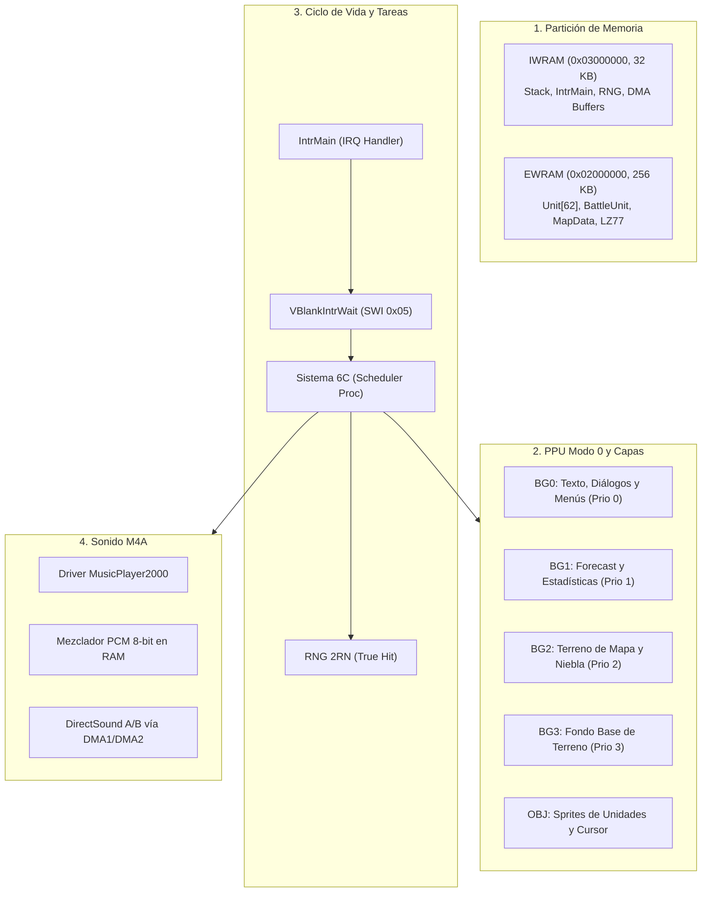

# Anatomía del Motor de Fire Emblem: The Blazing Blade

Este documento detalla el funcionamiento interno del motor de **Fire Emblem: The Blazing Blade** (GBA, Intelligent Systems, 2003): su organización de memoria en el silicio de la consola, la asignación de capas gráficas en Modo 0, el ciclo de vida de cada fotograma, el sistema de corrutinas tácticas y el pipeline de audio.

---

## Contexto

Cuando un binario comercial de Game Boy Advance se traduce Ahead-Of-Time a código C11 estándar mediante `gba-recomp`, el compilador anfitrión no "emula" el juego: compila de forma nativa las mismas rutinas, estructuras de datos y algoritmos diseñados por Intelligent Systems hace más de dos décadas. Para quien investiga, optimiza o depura este port nativo, tratar el juego como una masa anónima de 144.875 bloques hexadecimales impide diagnosticar fallos de temporización, regresiones de píxel o pérdidas de sincronía.

La Game Boy Advance ofrece un entorno de recursos estrictamente limitados:
- **CPU:** ARM7TDMI a 16.78 MHz con arquitecturas de instrucción ARM (32 bits) y Thumb (16 bits).
- **IWRAM (Internal Work RAM):** 32 KB en bus de 32 bits a velocidad completa de la CPU (0 ciclos de espera).
- **EWRAM (External Work RAM):** 256 KB en bus de 16 bits conectado a la placa base (2 ciclos de espera por acceso).
- **VRAM (Video RAM):** 96 KB compartidos con la PPU para caracteres y mapas de baldosas (*tilemaps*).
- **OAM y Paleta:** 1 KB de memoria interna dedicada a 128 atributos de sprites y 512 colores RGB555.

*Fire Emblem: The Blazing Blade* (conocido internamente como FE7) es la evolución directa del motor de *Fire Emblem: Fūin no Tsurugi* (FE6). El equipo de Intelligent Systems diseñó una arquitectura de software orientada a optimizar el ancho de banda del bus de memoria y coordinar cálculos tácticos deterministas con transiciones visuales ricas en mezclas alfa y efectos de animación.

---

## Idea Central

La arquitectura del motor de *Fire Emblem 7* se articula en seis subsistemas fundamentales que interactúan con el hardware de la consola y con el runtime recompilado:



---

### 1. Partición de Memoria: IWRAM Rápida vs. EWRAM Masiva

El motor separa rigurosamente sus estructuras de datos para evitar cuellos de botella en el bus de 16 bits de la EWRAM:

| Región | Dirección Base | Tamaño | Bus y Latencia | Contenido en *Fire Emblem 7* |
| :--- | :---: | :---: | :---: | :--- |
| **IWRAM** | `0x03000000` | 32 KB | 32-bit (0 wait states) | Pila de llamadas (`sp` inicializado en `0x03007F00`), despachador de interrupciones `IntrMain` (copiado desde ROM en el arranque), colas de transferencias DMA inmediatas, estados del temporizador y las 3 semillas de 16 bits del generador RNG. |
| **EWRAM** | `0x02000000` | 256 KB | 16-bit (2+1 wait states) | Arreglo de unidades vivas (`Unit[62]`), estructuras de cálculo de combate (`BattleUnit` atacante y defensor), cuadrícula de casillas de terreno y movimiento, búfer de descompresión LZ77 para retratos y estados de eventos del capítulo. |
| **VRAM** | `0x06000000` | 96 KB | 16-bit (VRAM bus) | Bloques de caracteres (0 a 3 para fondos, 4 y 5 para sprites) y mapas de pantalla de 32×32 tiles asignados a cada capa de fondo. |

#### Estructura de Datos de Unidad (`Unit`)
En EWRAM, el juego reserva un arreglo estático de entidades de combate (`gUnitArray` en `0x0202BE48`). Cada unidad ocupa una estructura fija de 76 bytes (verificable en la descompilación canónica de referencia `fireemblem7u`, archivo `include/bmunit.h`, `struct Unit`) con la siguiente disposición canónica:
- `+0x00`: Puntero a la tabla de definición de personaje en ROM (`gCharacterData`).
- `+0x04`: Puntero a la tabla de clase en ROM (`gClassData`: topes de estadísticas, habilidades de movimiento).
- `+0x08`: Nivel actual (`u8`) y puntos de experiencia (`u8`).
- `+0x0C`: Coordenadas en el mapa: columna $X$ (`u8`) y fila $Y$ (`u8`).
- `+0x12`: Puntos de salud máximos y actuales.
- `+0x14`: Estadísticas activas (Fuerza/Magia, Habilidad, Velocidad, Defensa, Resistencia, Suerte, Constitución).
- `+0x1E`: Inventario de 5 ranuras (2 bytes por objeto: ID de arma y usos restantes).
- `+0x28`: Rangos de armas (Espada, Lanza, Hacha, Arco, Bastón, Ánima, Luz, Oscuridad).
- `+0x30`: Máscara de estado alterado (veneno, silencio, dormir, petrificación y turnos restantes).

#### Por qué Intelligent Systems reubicaba subrutinas de combate en IWRAM

En el hardware de Game Boy Advance, el procesador ARM7TDMI accede a distintas regiones de memoria con penalizaciones de latencia muy dispares:
- **Bus de la ROM (Game Pak):** Bus de 16 bits conectado a través del conector de cartuchos, con una latencia de 3 a 5 ciclos de espera (*waitstates*) por lectura no secuencial.
- **IWRAM (Internal Work RAM, `0x03000000`):** Integrada directamente en el chip de la CPU, posee un bus nativo de 32 bits a velocidad máxima con **0 ciclos de espera**.

Durante las secuencias de combate detalladas (animaciones de batalla, cálculo de golpes críticos, evaluación de evasión, interpretación de scripts de efectos y mezcla de audio por software a 60 FPS), la CPU debe despachar miles de instrucciones críticas por fotograma. Si estas rutinas se ejecutaran directamente desde la ROM del cartucho, la saturación del bus de 16 bits provocaría caídas perceptibles de fotogramas.

Por ello, Intelligent Systems implementó un mecanismo de **reubicación dinámica de código**: durante el inicio y la preparación de batallas, copia bloques de subrutinas matemáticas y de animación críticas (`0x030035C8` a `0x030036CC`, correspondientes a subrutinas de interpolación y cálculo de combate procedentes de la ROM en `0x08059E7C`, denominada `sub_8059E7C` en la descompilación comunitaria `fireemblem7u`) desde la ROM hacia la IWRAM rápida.

**Estado actual en el port:** Estas subrutinas reubicadas en IWRAM **aún no están catalogadas** en [`blazing.labels.toml`](../../blazing.labels.toml) (ver tarea registrada en [`docs/PENDIENTES.md`](../PENDIENTES.md)). Por ello, durante los cálculos de combate, sus saltos caen temporalmente al intérprete de respaldo de CPU en `gba-core`.

**El desafío en la recompilación estática (AOT):**  
En un recompilador como `gba-recomp`, el código residente en RAM es potencialmente volátil. Para preservar la fidelidad absoluta:
1. El compilador C11 inserta una función de guardia (`guard`) con un hash FNV-1a de 64 bits para comprobar que los bytes presentes en IWRAM coinciden con la firma estática conocida antes de ejecutar el bloque compilado.
2. Si una subrutina en IWRAM no está mapeada en `blazing.labels.toml`, el salto indirecto no encuentra un bloque nativo compilado y cae de emergencia al intérprete en Rust de `gba-core`.

Por esta razón, catalogar y etiquetar las subrutinas de combate de IWRAM en `blazing.labels.toml` es un objetivo prioritario del proyecto: permitirá compilar bloques C11 nativos que corran a velocidad de CPU anfitriona sin caer al intérprete, manteniendo la verificación de integridad mediante `guard`.

---

### 2. Composición de Pantalla en Modo 0 y Fondos Afines

Durante las fases tácticas de mapa y los diálogos de historia, la PPU opera en **Modo 0** (cuatro capas de fondos de baldosas independientes de 240×160 píxeles). La asignación de prioridades (`BGxCNT`) sigue una jerarquía estricta:

```text
[Visor del Jugador]
      │
      ▼
┌──────────────┐  Prioridad 0: BG0 (Texto, cuadros de diálogo, ventanas de ayuda contextual)
├──────────────┤  Prioridad 1: BG1 (Pronóstico de combate, barra de información de casillas)
├──────────────┤  Sprites OBJ: Unidades aliadas/enemigas, cursor táctico, barras de HP
├──────────────┤  Prioridad 2: BG2 (Mapa de terreno, cuadrícula de casillas, niebla de guerra)
├──────────────┤  Prioridad 3: BG3 (Fondo base de terreno, nubes o degradado de atmósfera)
└──────────────┘  Fondo base (Color de fondo de paleta 0x05000000)
```

1. **BG0 (Prioridad 0 - Máxima):** Aloja los textos de diálogos, cuadros de comandos ("Atacar", "Objeto", "Esperar") y fuentes tipográficas con compresión variable.
2. **BG1 (Prioridad 1):** Dibuja los marcos semitransparentes de pronóstico de batalla (*Combat Forecast*) y los paneles informativos del terreno (porcentaje de evasión y defensa de un bosque o fuerte).
3. **BG2 (Prioridad 2):** Dibuja el mapa de baldosas del capítulo. Cuando hay niebla de guerra (*Fog of War*), BG2 aplica mezclas alfa con la paleta de oscurecimiento para enmascarar las regiones fuera del rango de visión.
4. **BG3 (Prioridad 3 - Mínima):** Dibuja los fondos estáticos bajo el terreno transitable (como precipicios o el mar exterior).
5. **Sprites OBJ:** Se intercalan entre las capas de fondos mediante el bit de prioridad de cada entrada en la OAM, permitiendo que una unidad quede cubierta visualmente cuando entra a un tejado o árbol denso.

#### Fondo Afín en Menús (Modo 1)
En los menús de selección de partida, preparación de batalla y títulos de capítulos, el motor conmuta la PPU a **Modo 1**. En este modo, **BG2 se convierte en un fondo afín** con matriz de transformación $2\times2$ (`PA, PB, PC, PD`) y coordenadas de referencia (`BG2X, BG2Y`). El motor aplica rotaciones continuas y pulsaciones de escala senoidales para generar el fondo giratorio característico de la franquicia.

---

### 3. Ciclo de Vida del Fotograma y Despacho de Interrupciones

El ciclo de ejecución de FE7 no utiliza bucles de espera activa (*busy-waiting*): se sincroniza de forma determinista con el barrido vertical de la pantalla mediante la interrupción VBlank de la consola:

1. **Líneas activas (0 a 159):** La CPU ejecuta la lógica del turno, cálculos de la IA o actualización de animaciones.
2. **Entrada a VBlank (Línea 160):** La PPU genera la interrupción IRQ de VBlank en el registro `DISPSTAT`.
3. **Atención por `IntrMain`:** El procesador toma la excepción hardware de IRQ en el vector canónico de la BIOS (`0x00000018`). La rutina de BIOS lee el puntero de usuario ubicado en la palabra superior de la IWRAM (`0x03007FFC`, vector de usuario), el cual apunta a la función `IntrMain` (copiada desde la ROM a IWRAM durante el inicio). `IntrMain` lee el registro `REG_IF` (`0x04000202`), reconoce la señal `IRQ_VBLANK` y despierta las rutinas que aguardaban sincronización.
4. **Suspensión con `VBlankIntrWait` (`SWI 0x05`):** Durante la lógica de cada frame, el bucle principal invoca la llamada de BIOS `VBlankIntrWait`. Esta instrucción apaga el reloj de la CPU en modo de bajo consumo (*Halt*) hasta que el hardware de video alcanza el VBlank, ahorrando batería y garantizando una cadencia exacta de 59.727 Hz.
5. **Intervalo VBlank (Líneas 160 a 227):** El intervalo físico de borrado vertical dura 68 scanlines ($160 \le Y \le 227$). En el registro `DISPSTAT`, el bit 0 (VBlank Flag) se mantiene en `1` durante las líneas 160 a 226 y cae a `0` en la línea 227 (según la especificación de hardware documentada en GBATEK, el bit se desactiva un scanline antes de que `VCOUNT` reinicie a cero). Durante estos 68 scanlines en que el cañón de electrones regresa al origen, el motor ejecuta transferencias críticas por DMA:
   - DMA3 vuelca el búfer de 128 sprites desde IWRAM a la memoria real OAM (`0x07000000`).
   - Actualización de los 512 colores en la memoria de paleta (`0x05000000`).
   - Copia de nuevos caracteres de baldosas a VRAM.

---

### 4. El Programador Cooperativo de Corrutinas: Sistema "Proc" (6C)

Intelligent Systems estructuró toda la lógica de alto nivel de *Fire Emblem* alrededor de un motor interno de corrutinas denominado **Proc** (conocido en los símbolos desensamblados como el sistema **6C** por su identificador de estructura).

Un *Proc* es un árbol jerárquico de procesos cooperativos. Cada proceso cuenta con:
- Una lista de comandos secuenciales (equivalente a un script compilado).
- Rutinas de actualización por fotograma (`OnInit`, `OnLoop`, `OnEnd`).
- Relaciones de jerarquía (procesos padre que se pausan automáticamente hasta que sus hijos concluyen).

El sistema 6C gobierna desde tareas globales (el bucle del mapa, el selector de turnos del jugador/enemigo) hasta tareas atómicas (el movimiento fluido de una unidad entre casillas, el desvanecimiento de un cuadro de texto o la animación de subida de nivel). En el código recompilado C11, estas rutinas aparecen bajo prefijos como `Proc_Start`, `Proc_Run` y `Proc_Break`.

---

### 5. Generador Pseudoaleatorio (RNG) y Sistema "True Hit" (2RN)

El sistema de combate de *Fire Emblem 7* es célebre en la comunidad táctica por el empleo del sistema **2RN** (*Two Random Numbers* o tirada doble).

#### El Generador LCG en IWRAM
El estado del generador reside en tres palabras de 16 bits en IWRAM (`gRNGState[3]`). Cada invocación de `RNG_Advance` avanza la secuencia mediante una combinación lineal congruencial:
$$R_1 = (R_1 \times 5 + 1) \pmod{65536}$$
La función devuelve un entero en el rango $[0, 99]$.

#### La Fórmula "True Hit"
A diferencia de los juegos de rol que comparan un único número aleatorio contra el porcentaje mostrado, *Fire Emblem 7* genera **dos números aleatorios independientes** ($r_1, r_2$) y calcula su promedio:
$$\text{Tirada} = \left\lfloor \frac{r_1 + r_2}{2} \right\rfloor$$
El ataque impacta si $\text{Tirada} < \text{Precisión}$.

Esta media de dos variables uniformes produce una **distribución triangular**:
- Los valores centrales se preservan cercanos a la probabilidad nominal (un 50% mostrado tiene un 50.5% real).
- Las probabilidades altas se amplifican favorablemente: un 90% visual equivale en realidad a un **98.1% real**.
- Las probabilidades bajas se atenúan: un 10% visual se reduce a un **1.9% real**.

El jugador percibe un juego táctico más justo y predecible, reduciendo la frustración de fallar ataques con alta ventaja estadística.

---

### 6. Pipeline de Audio: Driver Music Player 2000 (M4A)

El cartucho utiliza el estándar **Music Player 2000** (comúnmente abreviado como **M4A** o **MP2K**), desarrollado por Kensuke Matsushita:

```text
[Secuencias MIDI / Pistas de Audio]
               │
               ▼
┌───────────────────────────────┐
│     Driver M4A en la CPU      │
│  Mezclador por software a RAM │
└──────────────┬────────────────┘
               │
               ├─────────────────────────────────────────┐
               ▼                                         ▼
┌───────────────────────────────┐        ┌───────────────────────────────┐
│  DirectSound FIFO A (Música)  │        │ DirectSound FIFO B (Efectos)  │
│      Alimentado por DMA1      │        │      Alimentado por DMA2      │
└──────────────┬────────────────┘        └──────────────┬────────────────┘
               │                                         │
               └───────────────────┬─────────────────────┘
                                   ▼
┌────────────────────────────────────────────────────────────────────────┐
│     Núcleo gba-core (Captura MMIO: SOUNDCNT_H, SOUNDBIAS y DMA)        │
└──────────────────────────────────┬─────────────────────────────────────┘
                                   ▼
┌────────────────────────────────────────────────────────────────────────┐
│   Backend Android Nativo (AAudio / Oboe - v0.2.0 / Fase 2 del Roadmap) │
└────────────────────────────────────────────────────────────────────────┘
```

1. **Mezclador por Software en CPU:** La CPU decodifica secuencias polifónicas y realiza la mezcla digital de muestras PCM de 8 bits en un búfer circular en RAM, normalmente a una tasa de muestreo de **13.379 Hz** (o 18.157 Hz según la complejidad de la escena).
2. **Transferencias DMA1 y DMA2:** El temporizador interno de la GBA desborda periódicamente y dispara los canales DMA1 y DMA2 en modo FIFO. Cada desbordamiento transfiere automáticamente 4 bytes a los registros `FIFO_A` (`0x040000A0`) y `FIFO_B` (`0x040000A4`) sin intervención continua de la CPU.
3. **Canales PSG Tradicionales de Game Boy:** Paralelamente a DirectSound, el chip sintetiza efectos de sonido clásicos mediante los registros `0x04000060`: Canales 1 y 2 (onda cuadrada con modulación de frecuencia y barrido), Canal 3 (onda arbitraria de 4 bits para bajos) y Canal 4 (ruido blanco para percusiones e impactos).
4. **Interacción con el Port y `gba-core`:**
   - La directiva `engine-hle = "m4a"` en `pack.toml` habilita la detección de las rutinas canónicas del reproductor.
   - La función `mp2k_frame_hook` en `src/recomp.rs` intercepta el avance de fotograma del driver musical.
   - En Android, las muestras PCM acumuladas por `gba-core` se encaminarán al motor de baja latencia `AAudio / Oboe` (planificado para `v0.2.0` / Fase 2).

---

### 7. Metodología y Fuentes de Verificación

Todas las estructuras de memoria, desplazamientos de atributos y flujos de control descritos en esta anatomía se fundamentan en tres fuentes técnicas objetivas y comprobables:

1. **Descompilación canónica comunitaria (`fireemblem7u`):**
   Las definiciones de estructuras en C (`struct Unit`, `struct BattleUnit`, `struct ProcCmd` del despachador 6C) coinciden con los encabezados del proyecto de descompilación de *Fire Emblem 7* (`include/bmunit.h`, `include/proc.h`), el cual ha verificado la equivalencia binaria del código de Intelligent Systems.
2. **Inspección de código y prólogos con scripts del repositorio:**
   Cualquier dirección de función o tabla en ROM puede verificarse directamente sobre la ROM europea pinneada mediante las herramientas de ingeniería inversa incluidas en el proyecto:
   ```bash
   python scripts/diagnostico/desensamblar_rom.py --addr 0x08000000 --count 20
   python scripts/diagnostico/desensamblar_rom.py --buscar-prologo 0x08059E7C
   ```
3. **Mapa canónico de etiquetas (`blazing.labels.toml`):**
   Las 18.483 funciones catalogadas en el archivo de configuración del proyecto asignan identificadores semánticos, puntos de entrada canónicos y modo de procesador (Thumb o ARM) a cada subrutina en ROM, permitiendo rastrear las dependencias del código C11 recompilado (las firmas de tipos C/ATPCS no forman parte del mapa TOML y se derivan de los encabezados de descompilación o del generador AOT).

---

## Alternativas y Compromisos

1. **Documentar el motor frente a tratar el juego como caja negra:**
   - *Alternativa descartada:* Omitir la arquitectura original y limitar la documentación exclusivamente a la capa de envoltura Rust y shaders WGSL.
   - *Compromiso adoptado:* Abrir la anatomía interna de *Fire Emblem 7* con mapas de memoria, Modo 0 de la PPU y el sistema Proc/6C. Esto permite que los desarrolladores y la comunidad de ingeniería inversa comprendan con exactitud qué hace el código C11 generado y cómo optimizarlo.

2. **Fidelidad matemática de la distribución 2RN en AOT:**
   - La traducción estática preserva el generador pseudoaleatorio original de Intelligent Systems en C11. Cualquier modificación en el orden de las tiradas rompería la sincronización de partidas grabadas (*save states*) y el comportamiento canónico de la IA enemiga.

3. **Mapeo directo de memoria en la ruta de Hardware Shim:**
   - Conocer qué variables residen en IWRAM (`0x03000000`) frente a EWRAM (`0x02000000`) fundamenta la arquitectura de la Fase 2 del Hardware Shim (reemplazo de `RtApi` por memoria plana y eliminación del bucle de simulación ciclo a ciclo).
