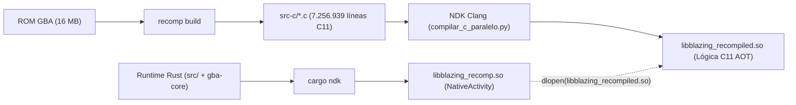

# Arquitectura y Guía de Lectura del Código C Recompilado

Esta explicación técnica documenta la estructura, convenciones y funcionamiento interno del código C11 generado por el recompilador estático (`recomp`) para **Fire Emblem: The Blazing Blade** en el repositorio **`blazing-recomp`**.

---

## Contexto y Modelo de Recompilación AOT

En la recompilación estática binaria, el código máquina original del procesador **ARM7TDMI** de la Game Boy Advance se traduce por adelantado (AOT - *Ahead of Time*) a código fuente en **C11 estándar**:



### Separación de Responsabilidades y Bibliotecas en el APK
El paquete APK para Android incluye dos bibliotecas nativas contiguas en `lib/<abi>/`:
* **`libblazing_recomp.so` (Runtime en Rust)**: Generada por `cargo ndk`. Actúa como punto de entrada de la `NativeActivity` de Android y modela el **hardware físico de la consola** (sincronización de ciclos, PPU nativa acelerada por GPU, audio, transferencias DMA y bus de memoria).
* **`libblazing_recompiled.so` (Lógica del juego en C11)**: Compilada de forma independiente con Clang del NDK. Modela **únicamente** la lógica aritmética y de control de la CPU (los 144.875 bloques C11 de *Fire Emblem*). En tiempo de ejecución en Android, `src/recomp.rs` carga dinámicamente esta biblioteca vía `dlopen("libblazing_recompiled.so")` y extrae los punteros `rcg_blocks` y `rcg_block_count`.

---

## Idea Central del Código Generado

El código máquina de *Fire Emblem 7* se recompila a C11 estructurado en una jerarquía clara de tres niveles:
1. **12 unidades de traducción C11** (`bios.0.c` a `bios.11.c`) que totalizan **7.256.939 líneas** y ~215,8 MB de código C.
2. **18.483 funciones canónicas catalogadas** en `blazing.labels.toml` (23 ARM y 18.460 Thumb; la cifra histórica de 17.207 correspondió a la cosecha inicial preliminar de etiquetas).
3. **144.875 bloques básicos compilados** (`rcg_blocks[]`), con un promedio de ~7.8 bloques por función.

Para permitir compilación paralela y evitar agotar la memoria de los compiladores anfitriones, `recomp build` divide la salida en unidades de traducción de aproximadamente **16 MB** (`MAX_UNIT`). El particionado se realiza exclusivamente cortando por fronteras de bloques completos (sin truncar funciones). La última unidad supera dicho umbral porque acumula los bloques finales y la tabla maestra de despacho:

| Archivo Generado | Tamaño Real | Líneas Reales | Función en el sistema |
| :--- | :--- | :--- | :--- |
| `1575 - Fire Emblem (E)(Independent)-bios.0.c` | ~18,9 MB | 640.265 | Declaración canónica de `RtApi`, `RcgBlock`, macros aritméticas de CPSR (`f_nz`, `op_adds`) y primeros bloques de código. |
| `1575 - Fire Emblem (E)(Independent)-bios.1.c` a `...bios.10.c` | ~11,5 - 21,4 MB c/u | 387.828 - 720.907 c/u | Unidades intermedias de bloques recompilados secuencialmente según el flujo del código del cartucho (5.803.603 líneas en conjunto). |
| `1575 - Fire Emblem (E)(Independent)-bios.11.c` | ~24,3 MB | 813.071 | Bloques finales y **tabla maestra de despacho**: el arreglo `rcg_blocks[]` con las 144.875 entradas cosechadas (`rcg_block_count = 144875`). |
| `1575 - Fire Emblem (E)(Independent)-bios.def` | 89 B | 6 | Archivo de exportaciones para el linker (`rcg_block_count` y `rcg_blocks`). |
| **Total (12 unidades C11)** | **~215,8 MB** | **7.256.939** | **Lógica AOT completa del juego en C11 estándar.** |

---

## Anatomía de una Función de Bloque

Cada bloque de código compilado representa una secuencia ininterrumpida de instrucciones que culmina en un salto o llamada:

```c
uint32_t b_08000a3e_t(const RtApi* a, void* m) {
    uint32_t* c = (uint32_t*)m;
    uint32_t pc; (void)pc;
    
    // 1. Ejecución de instrucciones
    c[13] = c[13] + 4u;
    a->tick(m, 2u);
    
    // 2. Retorno con la dirección del siguiente bloque
    return 0x08000a42u;
}
```

### Nomenclatura:
* `b_`: Prefijo de bloque (*block*).
* `08000a3e`: Dirección hexadecimal de memoria en la GBA donde reside este bloque.
  - Direcciones `08xxxxxx` pertenecen a la **ROM**.
  - Direcciones `03xxxxxx` pertenecen a la **IWRAM** rápida.
* `_t` o `_a`: Modo de instrucción:
  - `_t`: Modo **Thumb** (instrucciones compactas de 16 bits, el 95%+ de Fire Emblem).
  - `_a`: Modo **ARM** (instrucciones completas de 32 bits, rutinas críticas de interrupción o matemáticas).

### Parámetros:
* `const RtApi* a`: Puntero a la tabla de funciones del runtime (I/O, lectura y escritura de memoria, ciclos).
* `void* m`: Puntero opaco al contexto de la máquina (`Machine` en Rust). En C se castea a `uint32_t* c`, que apunta directamente al arreglo de **registros de la CPU**.

---

## Modelo de Registros de CPU (`c[...]`)

El arreglo `uint32_t* c` mapea directamente los registros del procesador ARM7TDMI:

| Índice en C | Registro GBA | Rol en el juego / ABI |
| :--- | :--- | :--- |
| `c[0] .. c[3]` | `r0 .. r3` | Parámetros de funciones y valores de retorno |
| `c[4] .. c[11]` | `r4 .. r11` | Variables locales preservadas por la llamada |
| `c[12]` | `r12` / `ip` | Intra-procedure call scratchpad |
| `c[13]` | `r13` / `sp` | Puntero de pila (*Stack Pointer*) |
| `c[14]` | `r14` / `lr` | Dirección de retorno (*Link Register*) |
| `c[15]` | `r15` / `pc` | Contador de programa (*Program Counter*) |
| `c[16]` | `CPSR` | Registro de estado actual del programa y banderas (N, Z, C, V) |

---

## La Interfaz del Runtime (`RtApi`)

El código C nunca accede a la memoria física mediante punteros directos ni realiza llamadas al sistema operativo. Toda interacción con el bus de la GBA, la sincronización de ciclos y el control de flujo pasa por la estructura canónica `RtApi` (definida en [`src-c/1575 - Fire Emblem (E)(Independent)-bios.0.c`](../../src-c/1575%20-%20Fire%20Emblem%20%28E%29%28Independent%29-bios.0.c) y `gba_core::capi::RtApi`):

```c
typedef struct {
    uint32_t (*interp_one)(void*);
    uint32_t (*read8)(void*, uint32_t);
    uint32_t (*read16)(void*, uint32_t);
    uint32_t (*read32)(void*, uint32_t);
    void (*write8)(void*, uint32_t, uint32_t);
    void (*write16)(void*, uint32_t, uint32_t);
    void (*write32)(void*, uint32_t, uint32_t);
    void (*tick)(void*, uint32_t);
    uint32_t (*guard)(void*, uint32_t, uint32_t, uint64_t);
    uint32_t (*chain_gate)(void*);
} RtApi;
```

### Propósito y Mecánica de los Campos de `RtApi`:

1. **Acceso al Bus de Memoria (`read8/16/32` y `write8/16/32`):**
   - Transfieren bytes, medias palabras (16 bits) o palabras completas (32 bits) hacia y desde el bus unificado de la consola (`gba_core::Bus`).
   - Manejan automáticamente los espejos de memoria (*memory mirrors*), los estados de espera (*waitstates*) de IWRAM, EWRAM y Game Pak ROM, y los efectos secundarios de la escritura en registros MMIO (`0x04000000` en adelante).

2. **Avance Temporal (`tick`):**
   - Notifica al runtime el consumo de ciclos de reloj ejecutados por el bloque para sincronizar los timers internos, el controlador DMA, el APU de audio y los barridos de línea de la PPU.

3. **Fallback Dinámico (`interp_one`):**
   - Ejecuta exactamente **una** instrucción de la CPU mediante el intérprete de respaldo cuando un salto dinámico (`bx`, `blx` o carga en `pc`) aterriza en una dirección que aún no tiene bloque nativo compilado.
   - Retorna la siguiente dirección de instrucción con el bit 0 indicando el modo Thumb (1) o ARM (0).

4. **Protección de Integridad en RAM (`guard`):**
   - Recibe la dirección base, la longitud en bytes y el hash esperado `FNV-1a` de 64 bits.
   - Se invoca al ingresar a bloques recompilados que residen en memoria dinámica (IWRAM `0x03xxxxxx` o EWRAM `0x02xxxxxx`).
   - Retorna `1` si el contenido en RAM no ha sido sobreescrito ni mutado por el juego; si el código fue alterado (código automodificable o buffers reutilizados), retorna `0` invalidando el bloque para redirigir la ejecución al intérprete.

5. **Compuerta de Encadenamiento (*Chain Gate* - `chain_gate`):**
   - Inspeccionado en las aristas de retorno de bucles encadenados nativos (*chained back-edges*).
   - Retorna `1` cuando el código nativo debe ceder obligatoriamente el control y retornar al bucle principal del despachador:
     - Se completó un fotograma (`frame_ready`).
     - La CPU entró en estado de bajo consumo o suspensión (`halted`).
     - Hay una interrupción hardware pendiente (`irq_pending`) y el bit de interrupción en CPSR está habilitado (`FLAG_I == 0`).
   - Esto evita que bucles de cálculo intensivo en código nativo dejen sin servicio la entrega de interrupciones o congelen el pacing de fotogramas a 60 FPS.

---

## Alternativas y Compromisos

* **Alternativa descartada:** Emulación con compilador JIT dinámico. Descartada por complejidad y consumo energético en dispositivos móviles frente a la traducción estática AOT a C11.
* **Alternativa descartada:** Acceso directo a punteros en memoria en lugar de `RtApi`. Descartada porque la GBA tiene regiones con espejos (*mirrors*), registros de E/S con efectos secundarios al leer/escribir y tiempos de espera de bus (*waitstates*).
* **Compromiso asumido:** El modelo de bloques estáticos requiere compilar previamente todas las unidades de traducción C11, requiriendo un entorno con NDK Clang y almacenamiento suficiente para los archivos intermedios generados.
