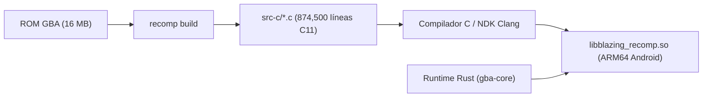

# Arquitectura y Guía de Lectura del Código C Recompilado

Esta explicación técnica documenta la estructura, convenciones y funcionamiento interno del código C11 generado por el recompilador estático (`recomp`) para **Fire Emblem: The Blazing Blade** en el repositorio **`blazing-recomp`**.

---

## Contexto y Modelo de Recompilación AOT

En la recompilación estática binaria, el código máquina original del procesador **ARM7TDMI** de la Game Boy Advance se traduce por adelantado (AOT - *Ahead of Time*) a código fuente en **C11 estándar**:



### Separación de Responsabilidades
* **Código C (`src-c/`)**: Modela **únicamente** la lógica aritmética y de control de la CPU (los 144.875 bloques C11 de la lógica del juego).
* **Runtime en Rust (`gba-core`)**: Modela el **hardware físico de la consola** (sincronización de ciclos, dibujo de líneas de pantalla del PPU, mezcla de audio APU/M4A, transferencias DMA y bus de memoria).

---

## Idea Central del Código Generado

Debido al volumen de instrucciones (más de 115,000 instrucciones descubiertas), el recompilador divide la salida en unidades de traducción de hasta **16 MB** (`MAX_UNIT`) para permitir compilación paralela y evitar agotar la memoria durante la compilación:

| Archivo Generado | Tamaño Estimado | Líneas Aprox. | Función en el sistema |
| :--- | :--- | :--- | :--- |
| `1575 - Fire Emblem (E)(Independent)-bios.0.c` | 17.7 MB | ~640,000 | Definición de `RtApi`, macros de banderas (`f_nz`, `op_adds`) y primeros ~13,000 bloques de código del juego. |
| `1575 - Fire Emblem (E)(Independent)-bios.1.c` | 6.4 MB | ~160,000 | Bloques restantes y **tabla maestra de despacho**: el arreglo `rcg_blocks[]` con las 144.875 entradas (`rcg_block_count = 144875`). |
| `1575 - Fire Emblem (E)(Independent)-bios.def` | 89 B | 6 | Archivo de exportaciones para el linker (`rcg_block_count` y `rcg_blocks`). |

---

## Anatomía de una Función de Bloque

Cada bloque de código compilado representa una secuencia ininterrumpida de instrucciones que culmina en un salto o llamada:

```c
uint32_t b_08000a3e_t(const RtApi* a, void* m) {
    uint32_t* c = (uint32_t*)m;
    uint32_t pc; (void)pc;
    
    // 1. Ejecución de instrucciones
    c[13] = c[13] + 4u;
    a->tick(m, 2u);
    
    // 2. Retorno con la dirección del siguiente bloque
    return 0x08000a42u;
}
```

### Nomenclatura:
* `b_`: Prefijo de bloque (*block*).
* `08000a3e`: Dirección hexadecimal de memoria en la GBA donde reside este bloque.
  - Direcciones `08xxxxxx` pertenecen a la **ROM**.
  - Direcciones `03xxxxxx` pertenecen a la **IWRAM** rápida.
* `_t` o `_a`: Modo de instrucción:
  - `_t`: Modo **Thumb** (instrucciones compactas de 16 bits, el 95%+ de Fire Emblem).
  - `_a`: Modo **ARM** (instrucciones completas de 32 bits, rutinas críticas de interrupción o matemáticas).

### Parámetros:
* `const RtApi* a`: Puntero a la tabla de funciones del runtime (I/O, lectura y escritura de memoria, ciclos).
* `void* m`: Puntero opaco al contexto de la máquina (`Machine` en Rust). En C se castea a `uint32_t* c`, que apunta directamente al arreglo de **registros de la CPU**.

---

## Modelo de Registros de CPU (`c[...]`)

El arreglo `uint32_t* c` mapea directamente los registros del procesador ARM7TDMI:

| Índice en C | Registro GBA | Rol en el juego / ABI |
| :--- | :--- | :--- |
| `c[0] .. c[3]` | `r0 .. r3` | Parámetros de funciones y valores de retorno |
| `c[4] .. c[11]` | `r4 .. r11` | Variables locales preservadas por la llamada |
| `c[12]` | `r12` / `ip` | Intra-procedure call scratchpad |
| `c[13]` | `r13` / `sp` | Puntero de pila (*Stack Pointer*) |
| `c[14]` | `r14` / `lr` | Dirección de retorno (*Link Register*) |
| `c[15]` | `r15` / `pc` | Contador de programa (*Program Counter*) |
| `c[16]` | `CPSR` | Registro de estado actual del programa y banderas (N, Z, C, V) |

---

## La Interfaz del Runtime (`RtApi`)

El código C nunca accede a la memoria física mediante punteros directos ni realiza llamadas al sistema operativo. Toda interacción con el bus de la GBA pasa por la estructura `RtApi`:

```c
typedef struct RtApi {
    void (*tick)(void*, uint32_t cycles);
    uint32_t (*rb)(void*, uint32_t addr);  // Read Byte
    uint32_t (*rh)(void*, uint32_t addr);  // Read Halfword (16 bits)
    uint32_t (*rw)(void*, uint32_t addr);  // Read Word (32 bits)
    void (*wb)(void*, uint32_t addr, uint32_t val);  // Write Byte
    void (*wh)(void*, uint32_t addr, uint32_t val);  // Write Halfword
    void (*ww)(void*, uint32_t addr, uint32_t val);  // Write Word
    uint32_t (*swi)(void*, uint32_t comment);        // Software Interrupt (Llamadas a BIOS)
    ...
} RtApi;
```

---

## Alternativas y Compromisos

* **Alternativa descartada:** Emulación con compilador JIT dinámico. Descartada por complejidad y consumo energético en dispositivos móviles frente a la traducción estática AOT a C11.
* **Alternativa descartada:** Acceso directo a punteros en memoria en lugar de `RtApi`. Descartada porque la GBA tiene regiones con espejos (*mirrors*), registros de E/S con efectos secundarios al leer/escribir y tiempos de espera de bus (*waitstates*).
* **Compromiso asumido:** El modelo de bloques estáticos requiere compilar previamente todas las unidades de traducción C11, requiriendo un entorno con NDK Clang y almacenamiento suficiente para los archivos intermedios generados.
