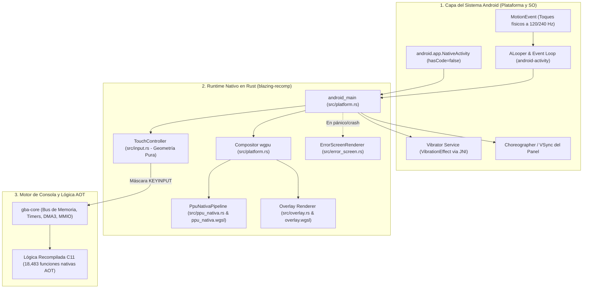

# Arquitectura y Componentes del Port Nativo de Android

Este documento explica en detalle la arquitectura interna de **`blazing-recomp`**, describiendo cómo están estructurados los diferentes subsistemas, cómo cooperan entre sí y cómo fluyen los datos y eventos desde la pantalla del dispositivo hasta el hardware y la GPU.

---

## Contexto y Plataforma Android

Blazing Recomp tiene como destino de ejecución nativa el sistema operativo Android en dispositivos móviles, tablets y televisores inteligentes (Android TV / TV Sticks). Ejecutar un juego de GBA recompilado nativamente en Android impone el reto de gestionar un ciclo de vida complejo de ventana nativa (`ANativeWindow`), coordinar la sincronización gráfica a 60 FPS, procesar eventos táctiles asíncronos y comunicarse con servicios de hardware (como el motor de vibración) sin degradar la batería ni incurrir en recolección de basura de la máquina virtual de Java.

---

## Idea Central de la Arquitectura en Capas

Para resolver estos desafíos sin acoplar la lógica de emulación a las APIs móviles, el proyecto está diseñado bajo una arquitectura desacoplada en tres capas principales:

---

## 2. Subsistemas y Responsabilidades

### 2.1. Punto de Entrada y Módulo Raíz (`src/lib.rs`)
* **Propósito:** Define la biblioteca dinámica (`cdylib`) que Android carga al instanciar la `NativeActivity`.
* **Separación de entornos:**
  * Expone públicamente los módulos puros (`input`, `overlay`, `overlay_shader`, `error_screen`, `ppu_nativa`) compilables y testeables en cualquier máquina de desarrollo (Windows, macOS, Linux).
  * Concatena condicionalmente bajo `#[cfg(target_os = "android")]` el módulo `platform`, exportando el símbolo nativo `android_main`.

### 2.2. Entrada Táctil y Ergonomía (`src/input.rs`)
* **Propósito:** Gestión determinista de colisiones y cálculo de la máscara de botones de la consola Game Boy Advance.
* **Características clave:**
  * **Cero dependencias de plataforma:** Funciona exclusivamente con geometría en números flotantes (`f32`) y matrices matemáticas.
  * **Disposición ergonómica estilo GBA SP:**
    * **Cruceta (D-Pad):** Cuenca circular continua con 4 zonas direccionales independientes y zona muerta central.
    * **Clúster diagonal de acción:** Botones **B** y **A** alineados en un eje inclinado a -16° a la derecha, con los gatillos **L** y **R** ubicados sobre el mismo eje perpendicular por encima.
    * **Select y Start:** Pastillas redondeadas centradas en la base.
  * **Auto-rotación dinámica:** El método `resize(w, h)` recalcula instantáneamente todas las áreas de colisión para los modos **Portrait** (pantalla vertical con controles ampliados en la mitad inferior) y **Landscape** (pantalla horizontal con controles flotantes translúcidos en las esquinas inferiores).
  * **Conversión a hardware:** `pressed_mask()` y `keyinput_mask()` generan el registro `KEYINPUT` de GBA (activo en nivel bajo: `0` = pulsado, `1` = libre), consumido directamente por el core.

### 2.3. Pipeline Gráfico Nativo en GPU (`src/ppu_nativa.rs` y `src/ppu_nativa.wgsl`)
* **Propósito:** Componer las capas de fondos (Backgrounds) y los sprites de la OAM directamente en la GPU mediante shaders `wgpu`, eliminando la sobrecarga del rasterizador por CPU (ADR 42).
* **Características clave:**
  * **Subida en bloque en VBlank:** Unifica la transferencia de líneas y estados de la PPU en una sola orden de subida durante la ventana de borrado vertical, evitando *tile flushes* prematuros en GPUs móviles TBDR.
  * **Texturas paletizadas R8:** Transfiere los índices de color en 1 byte por píxel (`R8_UINT`), resolviendo el color final en la memoria SRAM on-chip de la tesela del fragment shader (ahorro del 75% del tráfico en bus UMA).
  * **Composición por pases:** Procesa las 4 capas de fondos de texto y afines, evalúa las ventanas de recorte (Ventana 0, 1 y OBJ) y aplica los efectos de color (Alpha Blending, Brightness Increase/Decrease).

### 2.4. Renderizado de Controles GPU y Shaders Procedurales (`src/overlay.rs` y `src/overlay.wgsl`)
* **Propósito:** Dibujar los controles táctiles y la carcasa de la consola directamente en la GPU mediante `wgpu`.
* **Características clave:**
  * **Shader procedural continuo (SDF):** En lugar de cargar texturas PNG que se deforman o pixelan al cambiar de resolución, [`src/overlay.wgsl`](../../src/overlay.wgsl) calcula matemáticamente biseles 3D, sombras de caída (*drop shadows*) e iluminación cóncava mediante funciones de distancia con signo (*Signed Distance Fields*).
  * **Atlas de glifos en arranque:** Durante el inicio, `src/overlay.rs` usa la biblioteca `fontdue` para rasterizar los caracteres tipográficos de los botones en una textura interna de 256×256 px en escala de grises.
  * **Poda espacial AABB:** Para permitir 60 FPS en GPUs de gama de entrada (como Mali-G31 y Adreno 610), el shader descarta de inmediato los píxeles fuera de las áreas de colisión, ahorrando hasta un 80% de cálculos trigonométricos.

### 2.5. Plataforma Android y Ciclo de Vida (`src/platform.rs`)
* **Propósito:** Orquestar el ciclo de vida de la aplicación Android, la superficie gráfica y los eventos de hardware.
* **Componentes principales:**
  * **`Compositor`:** Encapsula la instancia `wgpu::Device`, `wgpu::Queue` y la `Surface` configurada sobre la ventana `ANativeWindow`. Gestiona una latencia de swapchain de **2 fotogramas** (triple buffering real desde la Decisión 24) y escala el framebuffer nativo de 240×160 a la resolución final de la pantalla.
  * **Bucle de eventos no bloqueante:** Procesa eventos del sistema (`InitWindow`, `WindowResized`, `Pause`, `Resume`) mediante `poll_events`, drena los lotes de eventos táctiles en `input_events_iter()` y presenta el fotograma en sincronía con el `Choreographer`.
  * **Subsistema háptico (`Haptics`):** Conecta con el `VibratorService` de Android vía JNI nativo. Utiliza `VibrationEffect.createOneShot(35, -1)` (API 26+) con fallback al método legado `vibrate(long)` y purga de excepciones (`exception_clear`).

### 2.6. Diagnóstico de Fallos y Pantalla de Rescate (`src/error_screen.rs`)
* **Propósito:** Blindar la aplicación ante cualquier pánico nativo no controlado en Rust o fallo de wgpu.
* **Mecanismo:**
  * Un hook global en `std::panic::set_hook` captura el mensaje de error, archivo y línea.
  * Si la GPU falla o el motor colapsa, el renderizador bloquea el framebuffer en CPU con `ANativeWindow_lock` y dibuja un volcado de diagnóstico de emergencia con una tipografía bitmap incrustada de 8×16 px, evitando que la aplicación se cierre silenciosamente hacia el lanzador.

---

## 3. Integración con el Motor Oficial Upstream (`gba-recomp`)

El proyecto vincula sus componentes del bus y la CPU directamente al repositorio oficial Git [`JRickey/gba-recomp`](https://github.com/JRickey/gba-recomp) fijado a un commit inmutable (`rev = "de4edf59b872d887046d6a3b005e2df551b6d44c"`):

* **`gba-core`:**
  * Provee la estructura `Machine`, que gestiona la memoria de la consola (IWRAM, EWRAM, VRAM, OAM, Palette) y el mapa de registros MMIO (`DISPSTAT`, `VCOUNT`, `DMA3`).
  * Recibe la máscara `KEYINPUT` generada por `TouchController` o mandos físicos en cada ciclo de fotograma.
* **`armv4t`:**
  * Provee el decodificador de instrucciones para el intérprete de respaldo de 16 bits (Thumb) y 32 bits (ARM) en caso de bifurcaciones indirectas no resueltas.

---

## Alternativas y Compromisos

1. **Sin capa Java/Kotlin (`hasCode="false"`):** Simplifica radicalmente la arquitectura y acelera la compilación, pero exige interactuar manualmente con JNI mediante firmas crudas (`jni_sig!`, `jni_str!`) para acceder a servicios del sistema como la vibración y SAF.
2. **Cero emulación de PPU en CPU:** Se eliminó la rasterización por software línea a línea (`render_scanline`), asumiendo el compromiso de resolver fondos, sprites y mezclas directamente en shaders de GPU (`wgpu`), lo que asegura 59.7 FPS en chipsets de bajo consumo como el TV Stick (ADRs 41 y 42).
3. **Desacoplamiento de eventos por colas atómicas:** La alta tasa de muestreo táctil (120/240 Hz) se desacopla del bucle de renderizado a 60 FPS mediante colas atómicas libres de bloqueo, evitando contención en la CPU.
