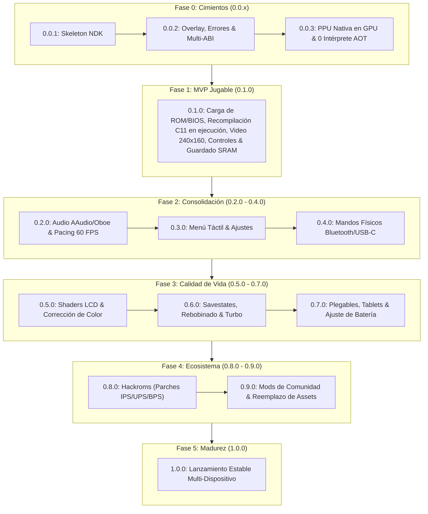

# Estrategia de Versionado Semántico y Roadmap Hacia la Versión 1.0

Este documento explica las decisiones arquitectónicas, la filosofía de versionado semántico y la estructura de hitos del roadmap de **Blazing Recomp** desde el prototipo inicial hasta el lanzamiento estable 1.0.

## Contexto

Blazing Recomp es un port nativo para Android de *Fire Emblem: The Blazing Blade* sustentado en recompilación estática anticipada (AOT) en C11 y un runtime de hardware en Rust (`gba-core`). 

Al tratarse de una aplicación móvil sobre Android (`NativeActivity`) que combina código nativo C/Rust, aceleración GPU y empaquetado de APK, requiere un esquema de versiones con dos objetivos simultáneos:
1. **SemVer 2.0.0 (`MAJOR.MINOR.PATCH`)**: Comunicación transparente a usuarios y desarrolladores del estado del software, alcance funcional y estabilidad de APIs nativas.
2. **`versionCode` de Android**: Entero monótonamente creciente requerido por el instalador del sistema operativo Android y tiendas de distribución para determinar actualizaciones válidas.

## Idea Central y Filosofía de Versiones

El versionado se organiza en torno a dos hitos canónicos:
- **`v0.1.0` (MVP Jugable):** Objetivo planificado: la versión mínima viable donde la ROM comercial y BIOS son verificadas, el bucle nativo arranca y el juego es completamente jugable de principio a fin con controles y guardado persistente en disco (`.sav`).
- **`v1.0.0` (Lanzamiento Estable y Completo):** La versión de producción final que opera sin fallos en todos los dispositivos Android compatibles, con menú nativo, gestión de partidas, filtros de pantalla/shaders, y capacidad de añadir mods y ejecutar hackroms comunitarios.

Todo el trabajo previo al primer arranque del juego se cataloga bajo el prefijo **`0.0.x`** (Fase de Cimientos y Prototipo), garantizando que las versiones no prometan capacidades que aún están en desarrollo en el motor. La versión actual del repositorio es **`0.0.3`**.

### Fórmula de Sincronización con Android

Para garantizar concordancia determinista entre el archivo `Cargo.toml` y `android/AndroidManifest.xml`, se adopta la fórmula estándar:

$$\text{versionCode} = \text{MAJOR} \times 10000 + \text{MINOR} \times 100 + \text{PATCH}$$

| SemVer | `versionName` | `versionCode` | Estado / Propósito |
| :--- | :--- | :--- | :--- |
| **`0.0.1`** | `"0.0.1"` | `1` | Prototipo inicial de ventana NDK y ciclo de vida de actividad. |
| **`0.0.2`** | `"0.0.2"` | `2` | Prototipo inicial de compositor GLES/Vulkan, overlay GBA SP, pantalla de errores y empaquetado multi-ABI. |
| **`0.0.3`** | `"0.0.3"` | `3` | **Versión actual**: PPU nativa en GPU (ADR 42), 60 FPS estables y cobertura AOT C11 completa en IWRAM con 0 pasos de intérprete. Persistencia `.sav` y audio en curso. |
| **`0.1.0`** | `"0.1.0"` | `100` | **Hito MVP planificado**: Juego arrancable y jugable de inicio a fin con controles y guardado persistente. |
| **`0.2.0`** | `"0.2.0"` | `200` | Subsistema de audio de baja latencia (AAudio/Oboe) y pacing 60 FPS. |
| **`0.3.0`** | `"0.3.0"` | `300` | Menú nativo en pantalla táctil (selector de archivos, ajustes de controles). |
| **`0.4.0`** | `"0.4.0"` | `400` | Soporte de mandos físicos (Bluetooth y USB-C) vía Android Gamepad API. |
| **`0.5.0`** | `"0.5.0"` | `500` | Shaders de pantalla GBA (corrección de color, rejilla LCD, scanlines). |
| **`0.6.0`** | `"0.6.0"` | `600` | Guardados de estado instantáneos (Savestates), rebobinado y avance rápido. |
| **`0.7.0`** | `"0.7.0"` | `700` | Adaptación para pantallas plegables, tablets y optimización por SoC. |
| **`0.8.0`** | `"0.8.0"` | `800` | Soporte de hackroms mediante aplicación de parches IPS/UPS/BPS al vuelo. |
| **`0.9.0`** | `"0.9.0"` | `900` | Sistema de mods comunitarios (assets HD, textos, audio orquestado). |
| **`1.0.0`** | `"1.0.0"` | `10000` | Versión final completa y estable para todos los dispositivos. |

## Estructura del Roadmap

## Alternativas y compromisos

- **Comenzar directamente en `1.0.0-beta`:**
  - *Descartada:* En la comunidad de código abierto, usar versiones `1.x` prematuramente comunica que el software ya es apto para usuarios finales cotidianos. Mantenerse en `0.0.x` hasta el MVP y en `0.x` hasta completar el set de funcionalidades previene expectativas falsas de soporte y estabilidad.
- **Incrementar `versionCode` manualmente sin fórmula:**
  - *Descartada:* Dejar `versionCode` al criterio humano sin una regla estricta suele provocar colisiones cuando se publican builds de prueba entre ramas o versiones parche. La fórmula $\text{MAJOR}\times 10000 + \text{MINOR}\times 100 + \text{PATCH}$ deja margen suficiente (hasta 100 parches por versión menor) y garantiza orden ascendente siempre.

## Relacionado

- [Directrices de arquitectura y portabilidad](../../AGENTS.md)
- [Backlog priorizado de tareas](../BACKLOG.md)
