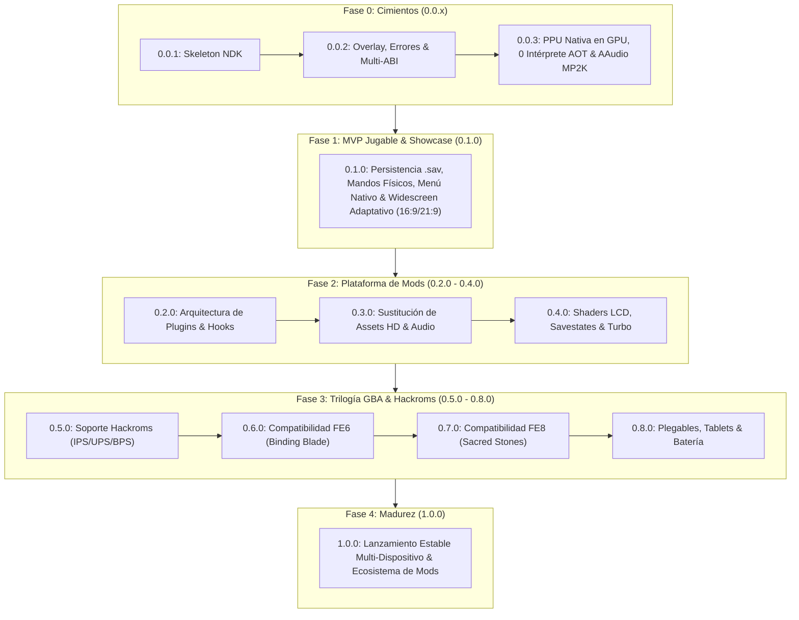

# Estrategia de Versionado Semántico y Roadmap Hacia la Versión 1.0

Este documento explica las decisiones arquitectónicas, la filosofía de versionado semántico y la estructura de hitos del roadmap de **Blazing Recomp** desde el prototipo inicial hasta el lanzamiento estable 1.0 como plataforma de recompilación nativa y extensible.

## Contexto

Blazing Recomp es una plataforma nativa de recompilación para Android de *Fire Emblem: The Blazing Blade* (proyectada hacia la trilogía completa de GBA) sustentada en recompilación estática anticipada (AOT) en C11, aceleración directa en GPU (`NativePpu` con shaders WGSL), audio nativo multihilo de baja latencia con AAudio y un runtime modular en Rust.

Al tratarse de una aplicación móvil sobre Android (`NativeActivity`) que combina código nativo C/Rust, composición en GPU, empaquetado de APK y extensibilidad comunitaria, requiere un esquema de versiones con dos objetivos simultáneos:
1. **SemVer 2.0.0 (`MAJOR.MINOR.PATCH`)**: Comunicación transparente a usuarios y desarrolladores del estado del software, alcance funcional y estabilidad de APIs nativas.
2. **`versionCode` de Android**: Entero monótonamente creciente requerido por el instalador del sistema operativo Android y tiendas de distribución para determinar actualizaciones válidas.

## Idea Central y Filosofía de Versiones

El versionado se organiza en torno a hitos canónicos:
- **`v0.1.0` (MVP Jugable & Showcase):** La versión mínima viable donde la ROM comercial y BIOS son verificadas, el bucle nativo arranca, el juego es completamente jugable de principio a fin con guardado persistente en disco (`.sav`), mandos físicos y táctiles, menú nativo y **Widescreen adaptativo (16:9 y 21:9)** como demostración de las capacidades del port en GPU.
- **`v0.2.0 - v0.4.0` (Plataforma de Mods):** Creación de la infraestructura de plugins e inyección para la comunidad (sustitución de assets, audio de alta fidelidad, shaders y savestates).
- **`v0.5.0 - v0.8.0` (Trilogía GBA & Ecosistema):** Extensión del motor hacia *Fire Emblem 6* y *Fire Emblem 8*, parches de hackroms al vuelo y adaptaciones de pantalla extendida.
- **`v1.0.0` (Lanzamiento Estable y Completo):** La versión de producción final que opera sin fallos en todos los dispositivos Android compatibles, con soporte completo para la trilogía GBA y mods comunitarios.

Todo el trabajo previo al primer arranque jugable con guardado se cataloga bajo el prefijo **`0.0.x`** (Fase de Cimientos y Prototipo). La versión actual del repositorio es **`0.0.3`**.

### Fórmula de Sincronización con Android

Para garantizar concordancia determinista entre el archivo `Cargo.toml` y `android/AndroidManifest.xml`, se adopta la fórmula estándar:

$$\text{versionCode} = \text{MAJOR} \times 10000 + \text{MINOR} \times 100 + \text{PATCH}$$

La sincronización se gestiona de forma atómica mediante el script [`scripts/bump_version.py`](../../scripts/bump_version.py), el cual exige confirmación explícita previa de la persona antes de aplicar cualquier incremento en los manifiestos y la documentación:

```bash
# Validar sincronía unánime
python scripts/bump_version.py --check

# Simular incremento seguro antes de aplicar
python scripts/bump_version.py --dry-run --patch

# Aplicar incremento con confirmación interactiva
python scripts/bump_version.py --patch -m "Descripción de la corrección o feature validada"
```

| SemVer | `versionName` | `versionCode` | Estado / Propósito |
| :--- | :--- | :--- | :--- |
| **`0.0.1`** | `"0.0.1"` | `1` | Prototipo inicial de ventana NDK y ciclo de vida de actividad. |
| **`0.0.2`** | `"0.0.2"` | `2` | Prototipo inicial de compositor GLES/Vulkan, overlay GBA SP, pantalla de errores y empaquetado multi-ABI. |
| **`0.0.3`** | `"0.0.3"` | `3` | **Versión actual**: PPU nativa en GPU (ADR 42), 60 FPS estables, cobertura AOT C11 en IWRAM con 0 pasos de intérprete en combate y motor de audio AAudio con MP2K HLE flotante. Persistencia `.sav` en desarrollo activo. |
| **`0.1.0`** | `"0.1.0"` | `100` | **Hito MVP Jugable & Showcase**: Juego jugable de inicio a fin con persistencia `.sav`, soporte de mandos físicos (Bluetooth/USB) y táctiles, menú nativo básico y Widescreen adaptativo (16:9 / 21:9). |
| **`0.2.0`** | `"0.2.0"` | `200` | Arquitectura de plugins / hooks de inyección en Rust/C para intercepción de eventos y funciones. |
| **`0.3.0`** | `"0.3.0"` | `300` | Sistema de sustitución de assets (texturas HD, música y samples de audio HD para el mezclador flotante). |
| **`0.4.0`** | `"0.4.0"` | `400` | Shaders de pantalla LCD/CRT avanzados, guardados instantáneos (Savestates), avance rápido y rebobinado. |
| **`0.5.0`** | `"0.5.0"` | `500` | Soporte de hackroms mediante aplicación de parches IPS/UPS/BPS al vuelo en tiempo de carga. |
| **`0.6.0`** | `"0.6.0"` | `600` | Compatibilidad arquitectónica de motor con *Fire Emblem 6: The Binding Blade*. |
| **`0.7.0`** | `"0.7.0"` | `700` | Compatibilidad arquitectónica de motor con *Fire Emblem 8: The Sacred Stones*. |
| **`0.8.0`** | `"0.8.0"` | `800` | Adaptación y optimizaciones específicas para pantallas plegables, tablets y perfiles de ahorro de batería. |
| **`1.0.0`** | `"1.0.0"` | `10000` | Versión final completa y estable para todos los dispositivos con soporte de la trilogía GBA y mods. |

## Estructura del Roadmap



## Alternativas y compromisos

- **Comenzar directamente en `1.0.0-beta`:**
  - *Descartada:* En la comunidad de código abierto, usar versiones `1.x` prematuramente comunica que el software ya es apto para usuarios finales cotidianos. Mantenerse en `0.0.x` hasta el MVP y en `0.x` hasta completar el set de funcionalidades previene expectativas falsas de soporte y estabilidad.
- **Incrementar `versionCode` manualmente sin fórmula:**
  - *Descartada:* Dejar `versionCode` al criterio humano sin una regla estricta suele provocar colisiones cuando se publican builds de prueba entre ramas o versiones parche. La fórmula $\text{MAJOR}\times 10000 + \text{MINOR}\times 100 + \text{PATCH}$ deja margen suficiente (hasta 100 parches por versión menor) y garantiza orden ascendente siempre.

## Relacionado

- [Directrices de arquitectura y portabilidad](../../AGENTS.md)
- [Backlog priorizado de tareas](../BACKLOG.md)
